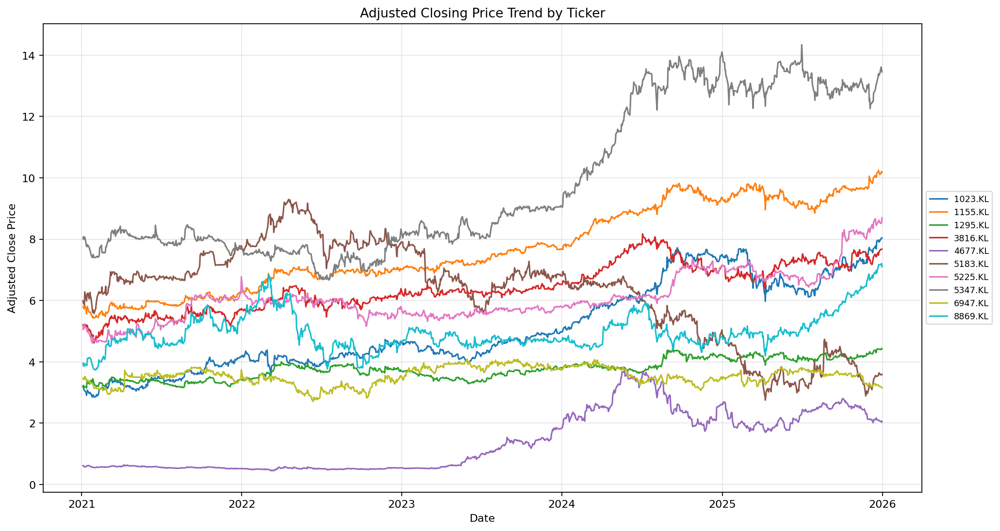
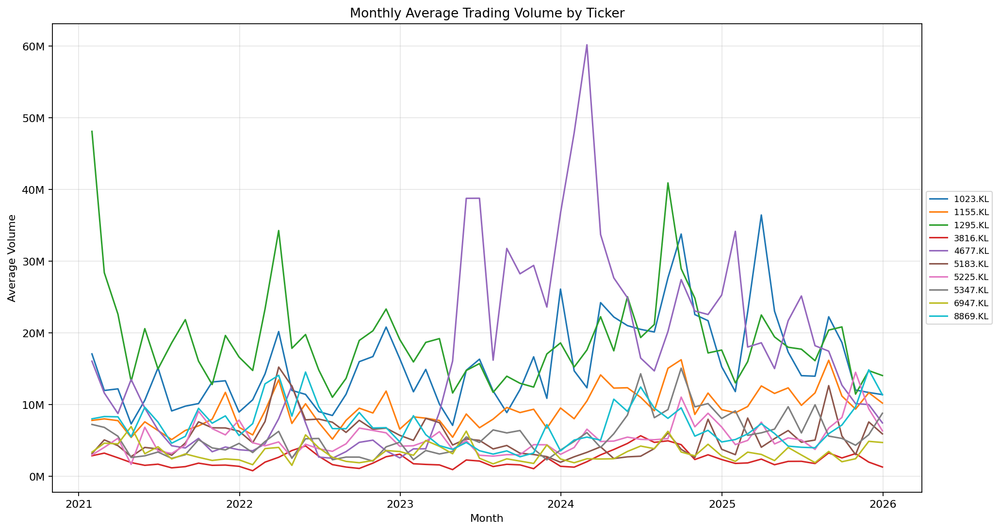
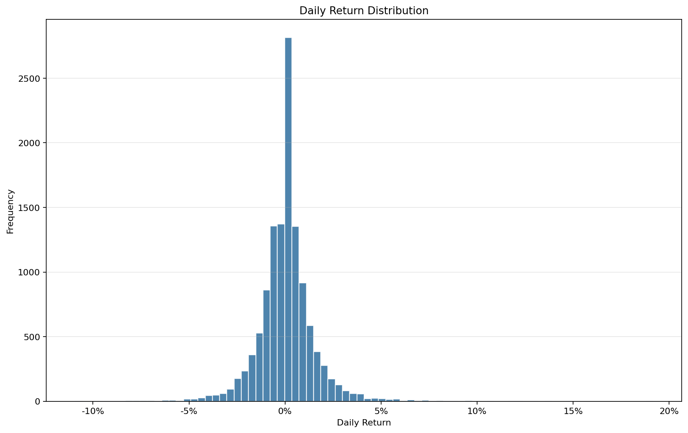
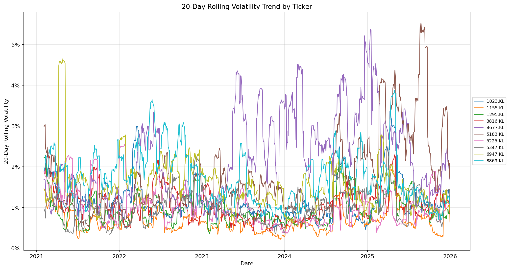
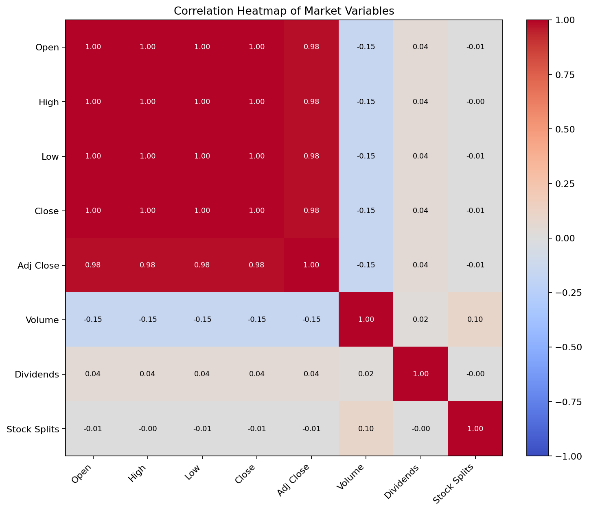
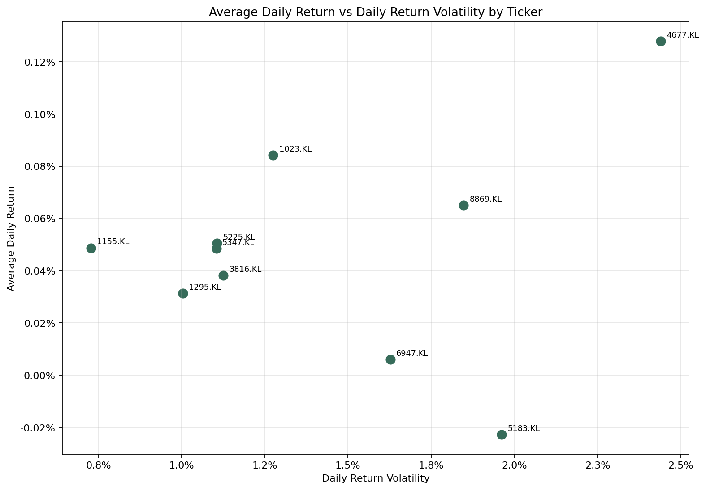
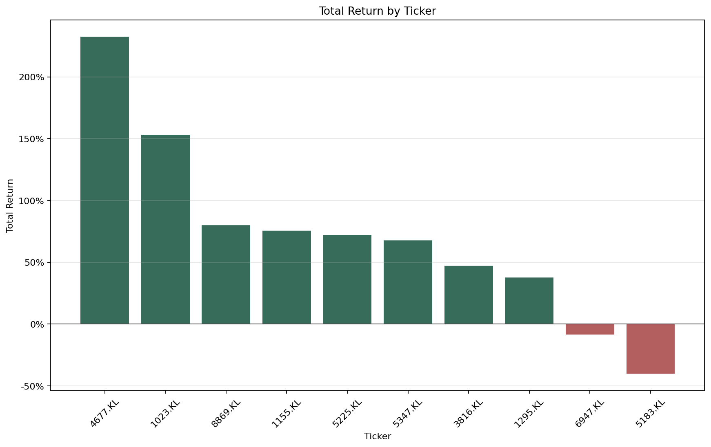
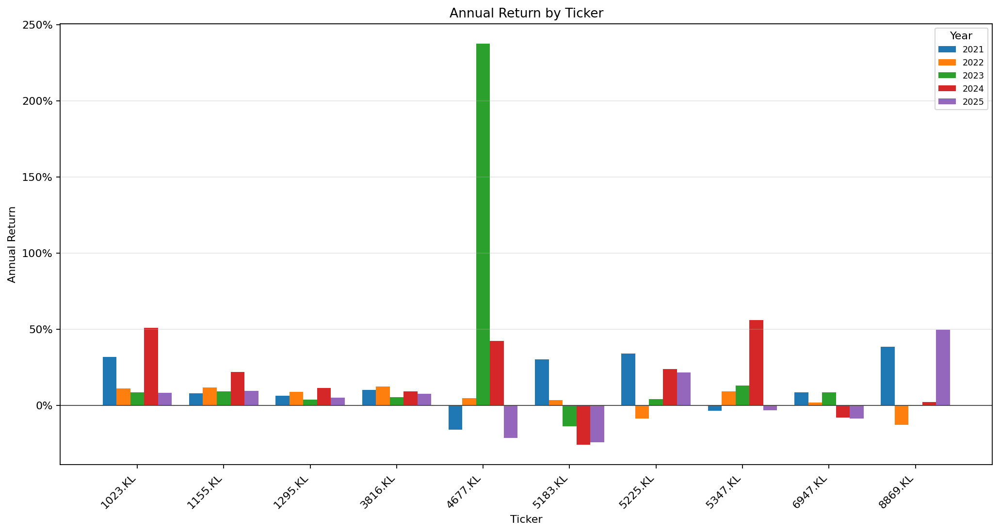
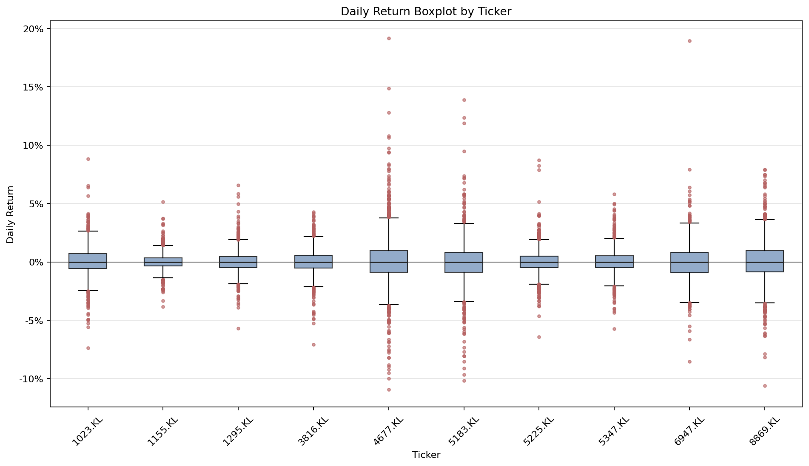
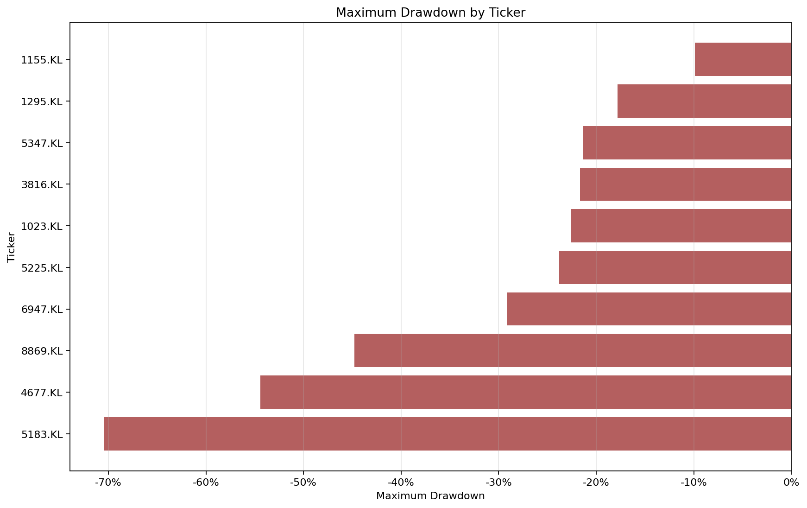

# 3.4.2.3 Exploratory Data Analysis (EDA) Summary

## Purpose
This section summarizes the numerical behavior of the preprocessed stock dataset.

## EDA Visualizations
The following charts are generated from the preprocessed dataset and saved under `summary/data-understanding/eda-charts/`.

### Adjusted Closing Price Trend

Shows long-term adjusted closing price movement for each stock ticker.

### Monthly Trading Volume Trend

Shows monthly average trading activity while reducing daily volume noise.

### Daily Return Distribution

Shows how daily percentage returns are distributed across the preprocessed dataset.

### 20-Day Rolling Volatility Trend

Shows how short-term return volatility changes over time for each ticker.

### Market Feature Correlation Heatmap

Shows relationships between numeric market variables in the preprocessed dataset.

### Return vs Volatility by Ticker

Compares each stock's average daily return against its daily return volatility.

### Total Return by Ticker

Compares overall adjusted-close return from the first available trading date to the last available trading date.

### Annual Return by Ticker

Compares year-by-year adjusted-close performance across tickers using grouped bars.

### Daily Return Boxplot by Ticker

Compares each stock's daily return spread, median, and outlier movement.

### Maximum Drawdown by Ticker

Compares the worst percentage decline from a previous adjusted-close peak for each stock.

## Descriptive Statistics
| Column       | Count  | Mean             | Std               | Min      | Q1        | Median    | Q3         | Max       |
| ------------ | ------ | ---------------- | ----------------- | -------- | --------- | --------- | ---------- | --------- |
| Open         | 12,230 | 6.150716         | 2.791891          | 0.51     | 4.25      | 5.9       | 8.03       | 15.04     |
| High         | 12,230 | 6.203697         | 2.80796           | 0.515    | 4.29      | 5.96      | 8.1        | 15.24     |
| Low          | 12,230 | 6.096461         | 2.77743           | 0.5      | 4.21      | 5.85      | 7.98       | 14.84     |
| Close        | 12,230 | 6.150838         | 2.792483          | 0.505    | 4.25      | 5.9       | 8.04       | 15.04     |
| Adj Close    | 12,230 | 5.507339         | 2.539038          | 0.447784 | 3.745868  | 5.468989  | 6.985693   | 14.336076 |
| Volume       | 12,230 | 8,933,348.789861 | 10,935,790.271211 | 0        | 2,844,200 | 5,767,000 | 11,221,375 | 383975900 |
| Dividends    | 12,230 | 0.001075         | 0.014633          | 0        | 0         | 0         | 0          | 0.58      |
| Stock Splits | 12,230 | 0.000572         | 0.048694          | 0        | 0         | 0         | 0          | 5         |

## Daily Return Summary By Ticker
| Ticker  | Return Count | Mean Return | Return Std | Minimum Return | Maximum Return |
| ------- | ------------ | ----------- | ---------- | -------------- | -------------- |
| 1023.KL | 1,222        | 0.000841    | 0.01275    | -0.073555      | 0.088189       |
| 1155.KL | 1,222        | 0.000487    | 0.007277   | -0.038462      | 0.051579       |
| 1295.KL | 1,222        | 0.000312    | 0.010039   | -0.056893      | 0.065737       |
| 3816.KL | 1,222        | 0.000381    | 0.011254   | -0.070539      | 0.042857       |
| 4677.KL | 1,222        | 0.001278    | 0.02439    | -0.109244      | 0.191589       |
| 5183.KL | 1,222        | -0.000227   | 0.019621   | -0.101538      | 0.138756       |
| 5225.KL | 1,222        | 0.000505    | 0.011063   | -0.064033      | 0.087329       |
| 5347.KL | 1,222        | 0.000484    | 0.011044   | -0.057307      | 0.058195       |
| 6947.KL | 1,222        | 0.000059    | 0.01627    | -0.085271      | 0.189334       |
| 8869.KL | 1,222        | 0.000651    | 0.018471   | -0.105906      | 0.07933        |

## Highest Absolute Correlations
| Column A | Column B  | Correlation |
| -------- | --------- | ----------- |
| Low      | Close     | 0.999798    |
| High     | Close     | 0.999786    |
| Open     | High      | 0.99977     |
| Open     | Low       | 0.999744    |
| High     | Low       | 0.999656    |
| Open     | Close     | 0.999572    |
| High     | Adj Close | 0.983442    |
| Close    | Adj Close | 0.983399    |
| Open     | Adj Close | 0.982974    |
| Low      | Adj Close | 0.982778    |
